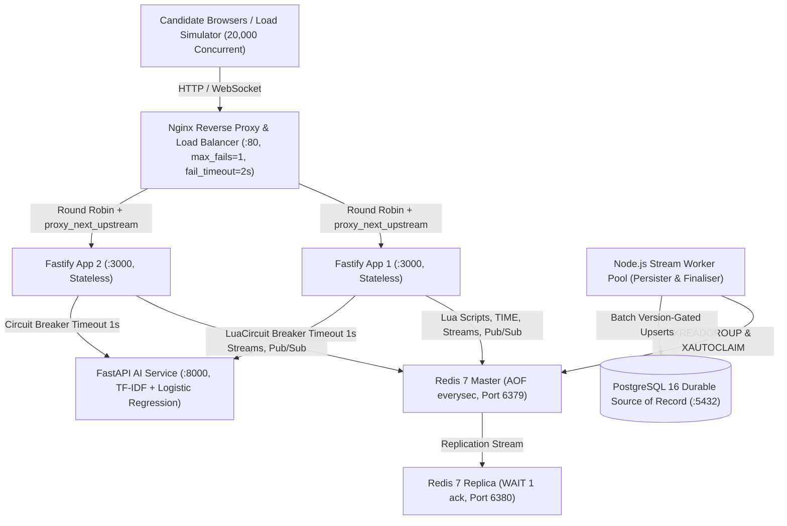
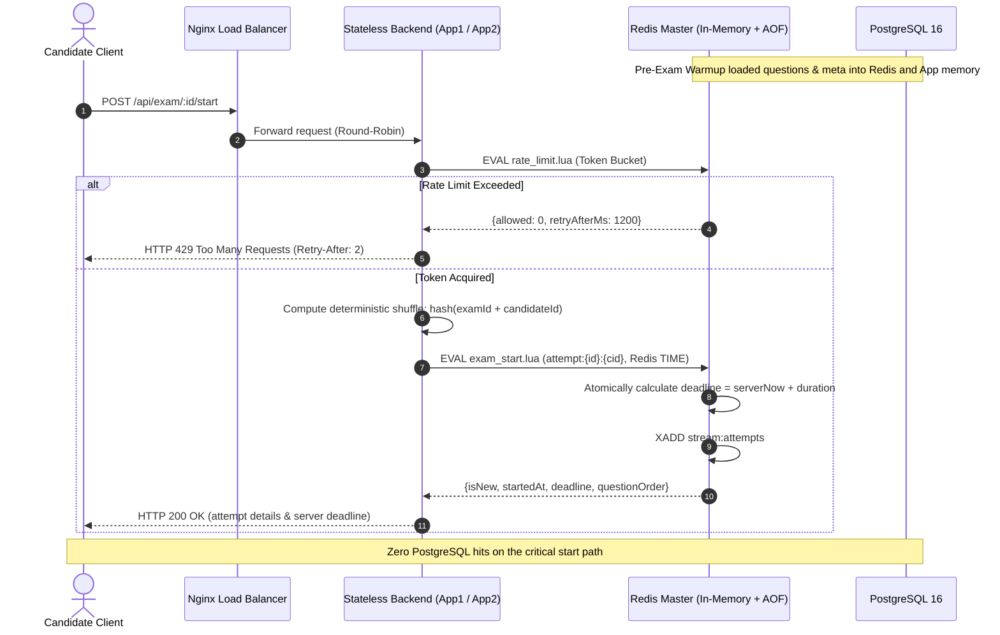
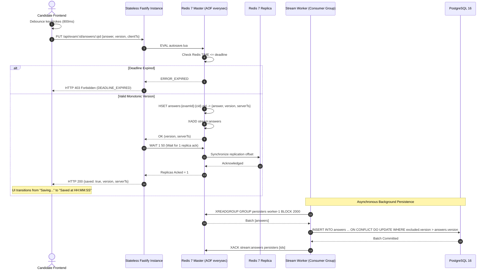
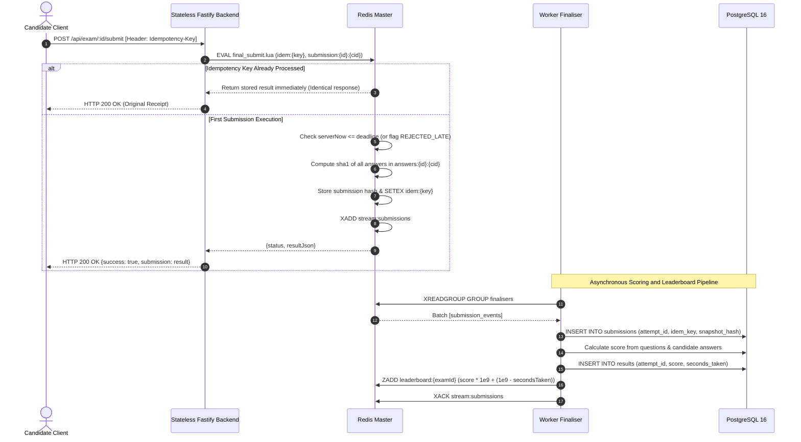

# ExamPulse System Architecture & Distributed Data Flows

ExamPulse is a server-authoritative, high-throughput distributed assessment platform engineered to start 20,000 simulated candidates within one minute, eliminate cache stampedes, guarantee zero lost acknowledged answers via Redis AOF and replica \`WAIT\`, enforce single active sessions and server-authoritative timers, and provide explainable AI collusion detection with rule-based fallback.

---

## 1. System Topology Overview



---

## 2. (a) The Start Path (Absorbing the Spike Without Cache Stampede)



---

## 3. (b) The Answer Save Path (Acknowledged Durability Guarantee)



---

## 4. (c) The Final Submission Path (Strict Idempotency & Rush Handling)



---

## 5. (d) Instance Failover Path (Zero-Downtime Resilience)

```mermaid
sequenceDiagram
    autonumber
    actor C as Candidate
    participant Nginx as Nginx Load Balancer
    participant App1 as App 1 (Failed Node)
    participant App2 as App 2 (Surviving Node)
    participant Redis as Shared Redis Master

    C->>Nginx: HTTP Request (PUT /answers/1)
    Nginx->>App1: Forward request
    Note over App1: App1 crashes / killed by operator
    App1--xNginx: TCP RST / Connection Refused / 502
    Note over Nginx: proxy_next_upstream error timeout (failover < 5s)
    Nginx->>App2: Retry request immediately
    App2->>Redis: Validate session:{cid} & save answer
    Redis-->>App2: {saved: true}
    App2-->>Nginx: HTTP 200 OK
    Nginx-->>C: HTTP 200 OK (Zero user impact, remaining time intact)
```



---

## 6. (e) Realtime Fan-Out & Explainable AI Collusion Pipeline

```mermaid
flowchart TD
    Candidates["Candidates Telemetry (Page Visibility, Tab Blur, Answers)"]
    Instances["Stateless App Instances (App1 & App2)"]
    RedisPub["Redis Pub/Sub (channel:dashboard:1)"]
    Aggregator["500ms Batched Delta Aggregator"]
    Dashboards["Invigilator WebSockets & Dashboard UI"]
    AiClient["AI Client (Circuit Breaker 1s Timeout)"]
    FastAPI["Python FastAPI AI Service (:8000)"]
    RuleFallback["Rule-Based Fallback Engine"]
    FlagStore[("PostgreSQL Flags & Audit Table")]

    Candidates -->|POST /api/events & heartbeats| Instances
    Instances -->|Publish events| RedisPub
    RedisPub -->|Subscribe| Aggregator
    Aggregator -->|Batch delta frames every 500ms| Dashboards

    Instances -->|Async Collusion Query| AiClient
    AiClient -->|Circuit State: CLOSED| FastAPI
    FastAPI -->|TF-IDF + LR Coefficients| AiClient
    AiClient -.->|Timeout / Connection Failure (Circuit OPEN)| RuleFallback
    AiClient -->|Advisory Collusion Flags with Contributions| FlagStore
    FlagStore -->|Review Action: Safe / Dismiss / Escalate| Dashboards
```
